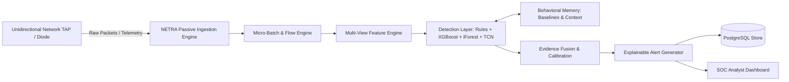

# 01_SRS.md — Software Requirements Specification

## NETRA — Network Early Threat Recognition & Analysis

**Document Version:** 1.0  
**Project Identifier:** SIH 2026 • Problem Statement 26145  
**Theme:** AI-Based Detection of Cyber Threats in Unidirectional IP Traffic  
**Architectural Stance:** Passive, Read-Only, Metadata-Based Inference (No Inline Blocking, No Active Probing, No Decryption)

---

## 1. Introduction

### 1.1 Purpose
This document specifies the software requirements for **NETRA** (Network Early Threat Recognition & Analysis), a passive, streaming threat-inference engine designed for unidirectional network segments. It establishes the functional, behavioral, performance, and interface requirements for academic evaluation, hackathon benchmarks, and technical validation under SIH Problem Statement 26145.

### 1.2 Problem Statement & Context
Critical enclaves, classified defense perimeters, industrial control systems (ICS/SCADA), and data diodes receive network telemetry through strictly one-way physical or logical taps. In these environments:
1. **No return path exists:** The monitoring system cannot send TCP ACKs, reset packets, ICMP messages, or challenge handshakes.
2. **No active probing is allowed:** The engine cannot scan suspect hosts or query remote endpoints.
3. **Payloads are opaque:** Modern traffic is end-to-end encrypted (TLS 1.3, QUIC, DoH/DoT) or forbidden from deep inspection by strict privacy/security mandates.
4. **Attacks are stealthy and temporal:** Low-and-slow command-and-control (C2) beacons, data exfiltration, DNS tunnelling, and domain generation algorithms (DGAs) unfold across extended time windows rather than single isolated packets.

Conventional intrusion detection systems (IDS/IPS) fail in this setting because they assume bidirectional TCP handshakes, inline packet blocking, or deep payload decryption. NETRA solves this by operating as a **passive multi-view threat inference system** that extracts rich streaming metadata, builds temporal entity baselines, and fuses multiple machine learning and rule-based detectors into calibrated, explainable alerts.

### 1.3 Scope

#### In-Scope:
- Passive ingestion of raw network traffic via PCAP replay and live network tap streams (NetFlow / IPFIX / sFlow).
- 5-tuple flow assembly and short micro-batch windowing (1–5 seconds).
- Multi-view metadata feature extraction: volumetric, inter-arrival timing, fan-out/diversity entropy, DNS lexical patterns, and TLS/QUIC handshakes (JA3/JA4 hashes, cipher suites, SNI).
- Entity-specific behavioral memory comparing real-time behavior against statistical source/destination baselines.
- Multi-model threat detection combining deterministic heuristics, supervised classification (XGBoost), anomaly detection (Isolation Forest), and temporal sequence modeling (Temporal Convolutional Networks - TCN).
- Evidence fusion computing a compound risk score (0–100), threat classification, calibrated confidence (0–100%), and uncertainty rating.
- Explainable security alerts detailing observable evidence, timeline progression, and contributing feature weights.
- SOC web dashboard displaying real-time threat streams, behavioral deviations, throughput, and latency metrics.

#### Out-of-Scope (Strict SIH Architectural Boundaries):
- **No inline packet blocking, packet dropping, or firewall manipulation:** NETRA produces threat intelligence and actionable alerts; it does not tamper with network links.
- **No active network scanning or probe generation:** Zero packets are transmitted onto the monitored link.
- **No payload decryption or cryptanalysis:** All inference relies strictly on visible protocol headers, packet dimensions, and temporal metadata.
- **No WAN-level MAC address geolocation:** Physical IP attribution is treated as contextual, avoiding unscientific L2 assumptions.

### 1.4 Definitions, Acronyms, and Abbreviations

| Term | Definition |
|---|---|
| **NETRA** | Network Early Threat Recognition & Analysis |
| **SIH** | Smart India Hackathon (Problem Statement 26145) |
| **C2** | Command and Control channel established by malware |
| **DGA** | Domain Generation Algorithm used by botnets for dynamic rendezvous |
| **Data Diode** | Hardware or optical tap device permitting unidirectional data transmission only |
| **Flow** | Unidirectional stream of packets sharing a 5-tuple (Src IP, Dst IP, Src Port, Dst Port, Protocol) |
| **Inter-Arrival Time (IAT)** | Time delta between consecutive packets in a flow or time window |
| **JA3 / JA4** | Cryptographic fingerprinting methods based on TLS Client Hello parameters |
| **NXDOMAIN** | DNS response code indicating a non-existent domain name |
| **TCN** | Temporal Convolutional Network (1D dilated causal convolutions for sequence modeling) |
| **SHAP** | SHapley Additive exPlanations for tree-based feature attribution |

### 1.5 Document References
- `02_Project_Requirements.md` — Requirement tiers, hardware/software specifications, and ML toolchains.
- `03_Architecture.md` — End-to-end data pipeline, streaming design, and component interaction.
- `04_Rules.md` — Operational boundaries, SIH constraints, and detection heuristics.
- `07_Memory.md` — Behavioral memory algorithms, baseline updates, and poisoning defense.
- `08_Database_Design.md` — Relational schema for flows, baselines, detections, and alerts.
- `09_Testing.md` — Evaluation protocol, ablation study design, and benchmark metrics.

---

## 2. Overall Description

### 2.1 Product Perspective
NETRA operates as an isolated analytics appliance situated downstream from an optical tap, port mirror (SPAN), or data diode. It receives an unacknowledged stream of network frames or telemetry records, ingests them into memory buffers, derives multi-dimensional statistical views, performs real-time model inference, and renders structured intelligence to an analyst dashboard.



### 2.2 System Stakeholders & User Classes

| User Class | Description | Primary Interactions |
|---|---|---|
| **SOC Security Analyst** | Investigates high-risk alerts and security incidents. | Reviews live alert stream, inspects SHAP evidence, correlates temporal timelines, marks incident disposition. |
| **Network Defense Operator** | Oversees ingestion pipelines, network health, and throughput. | Monitors flows/sec, pipeline latency, buffer back-pressure, and data source health. |
| **Security Researcher / ML Engineer** | Retrains models, configures detection thresholds, audits baselines. | Evaluates precision/recall metrics, reviews baseline drift, manages rollback snapshots. |
| **SIH Jury / Academic Evaluator** | Validates technical compliance against PS 26145 constraints. | Inspects PCAP replay scenarios, verifies read-only isolation, reviews ablation benchmarks. |

### 2.3 Operating Environment
- **Host Operating System:** Linux (Ubuntu 22.04 LTS / Debian 12) or Windows 10/11 with WSL2.
- **Python Runtime:** Python 3.10+ (64-bit).
- **Core ML Frameworks:** XGBoost, Scikit-Learn (Isolation Forest), PyTorch (TCN).
- **Data Processing Libraries:** Polars, NumPy, SciPy, Pandas.
- **Ingestion & Packet Tooling:** Scapy, dpkt, PyShark, Zeek TSV log parsers.
- **Backend Service:** FastAPI, Uvicorn, Pydantic v2.
- **Database:** PostgreSQL 15+ (with optional TimescaleDB extension for time-series flows).
- **Frontend / Visualization:** React (TypeScript + Vite + Tailwind CSS) or Streamlit for rapid demo validation.
- **Containerization:** Docker & Docker Compose.

---

## 3. Functional Requirements

### 3.1 Module 1: Ingestion & Flow Processing (FR-INGEST / FR-FLOW)

- **FR-INGEST-01: PCAP Ingestion & Replay**  
  The system shall ingest offline packet captures (`.pcap`, `.pcapng`) at configurable replay rates (1x, 2x, 5x, 10x, or wire speed) while preserving packet timestamps.
- **FR-INGEST-02: Live Unidirectional Stream Capture**  
  The system shall bind to designated network interfaces (NICs) in promiscuous, passive mode and consume incoming frames without generating any response packets (no ARP, no TCP RST/ACK, no ICMP).
- **FR-INGEST-03: Flow Aggregation**  
  The engine shall reconstruct unidirectional flows based on the standard 5-tuple:
  $$\text{Flow Key} = (\text{Src IP}, \text{Dst IP}, \text{Src Port}, \text{Dst Port}, \text{Transport Protocol})$$
- **FR-FLOW-01: Micro-Batch Windowing**  
  The system shall slice incoming traffic into sliding micro-batch temporal windows ranging from 1 to 5 seconds (default: 2.0 seconds) to enable near-real-time streaming inference without waiting for flow termination.
- **FR-FLOW-02: Flow State Expiration**  
  Active flows exceeding an idle timeout (default: 15 seconds) or an active timeout (default: 60 seconds) shall be flushed to the feature engine and archived.

### 3.2 Module 2: Multi-View Feature Extraction (FR-FEAT)

- **FR-FEAT-01: Volumetric & Basic Flow Metrics**  
  The engine shall compute total packet count, total byte count, packet size distribution (mean, standard deviation, min, max), packet rate (packets/sec), and byte rate (bytes/sec) for each micro-batch.
- **FR-FEAT-02: Temporal & Timing Metrics**  
  The engine shall calculate packet Inter-Arrival Time (IAT) statistics (mean, median, standard deviation, coefficient of variation), burstiness index, and autocorrelation periodicity score to expose automated beaconing.
- **FR-FEAT-03: Diversity & Fan-Out Entropy**  
  The engine shall compute Shannon entropy for destination IP addresses and destination ports per source host:
  $$H = -\sum_{i=1}^{k} p_i \log_2(p_i)$$
  alongside unique endpoint count, fan-out ratios, and connection concentration to identify reconnaissance scans and flood vectors.
- **FR-FEAT-04: DNS Metadata & Lexical Analysis**  
  For DNS traffic (UDP/TCP port 53), the engine shall passively extract query string length, subdomain depth, digit-to-alphabet ratio, Shannon entropy of domain labels, n-gram bigram/trigram likelihood, query frequency, and NXDOMAIN ratios.
- **FR-FEAT-05: TLS/QUIC Encrypted Flow Fingerprinting**  
  Without decrypting session content, the engine shall parse TLS Client Hello messages to extract the SNI server name, cipher suite lists, TLS extensions, elliptic curve points, and generate JA3/JA4 cryptographic fingerprint hashes.
- **FR-FEAT-06: Graph & Topological Features**  
  The engine shall calculate source node out-degree, destination node in-degree, new peer ratio, and bipartite relationship novelty relative to previously observed traffic.

### 3.3 Module 3: Multi-Model Detection Layer (FR-DETECT)

NETRA shall support detection across nine explicit threat classes:
1. SYN Flood
2. UDP Reflection / Amplification
3. Spoofed-Source Flood
4. C2 Beaconing
5. Domain Generation Algorithm (DGA)
6. DNS Tunnelling
7. Encrypted Malware Delivery / C2
8. Port / Endpoint Scanning
9. Covert Data Exfiltration

- **FR-DETECT-01: Deterministic Rule Engine**  
  The system shall evaluate declarative threshold rules defined in structured YAML/JSON for signature-like behavioral cues (e.g., extreme SYN/ACK imbalance, excessive fan-out rate, known blacklisted JA3 hashes, anomalous DNS query length > 65 characters).
- **FR-DETECT-02: Supervised Tabular Classifier (XGBoost)**  
  The system shall execute an optimized XGBoost gradient-boosted decision tree ensemble on tabular flow features to generate probability distributions over known threat classes:
  $$P(\text{Class}_k \mid \mathbf{x}), \quad k \in \{\text{BENIGN}, \text{DDoS}, \text{C2}, \text{DGA}, \dots\}$$
- **FR-DETECT-03: Unknown-Anomaly Detector (Isolation Forest)**  
  The system shall evaluate high-dimensional feature vectors through an Isolation Forest model trained exclusively on benign baselines to assign an unsupervised anomaly score $s \in [0, 1]$ for novel or zero-day behaviors.
- **FR-DETECT-04: Temporal Sequence Modeler (TCN)**  
  The system shall feed sequences of consecutive micro-batch feature vectors ($T = 10 \dots 30$ windows) into a 1D Dilated Temporal Convolutional Network to capture multi-stage attack escalation, slow port scans, and jittered C2 beacons that evade single-flow classifiers.

### 3.4 Module 4: Behavioral Memory Engine (FR-MEM)

- **FR-MEM-01: Entity Statistical Baseline Maintenance**  
  The system shall maintain rolling statistical summaries for monitored IP entities (mean packet rate, normal outbound volume range, known peer sets, habitual port lists, standard TLS JA3 signatures, normal DNS query volume).
- **FR-MEM-02: Anomaly & Deviation Scoring**  
  Current window features shall be evaluated against the entity baseline to produce normalized deviation ratios (e.g., $8.5\times$ normal outbound byte volume, first-seen external IP destination).
- **FR-MEM-03: Poisoning Protection & Controlled Baseline Updates**  
  Traffic identified as suspicious or high-risk ($Risk \ge 50$) shall be strictly quarantined from baseline updates. Validated normal traffic shall update baselines using exponential decay:
  $$\mu_{t} = (1 - \alpha)\mu_{t-1} + \alpha x_t \quad (\alpha = 0.05)$$
- **FR-MEM-04: Baseline Versioning & Rollback**  
  The memory subsystem shall persist versioned baseline snapshots and support manual or automated rollback if baseline corruption is detected.

### 3.5 Module 5: Evidence Fusion & Explainable Alerting (FR-FUSION / FR-ALERT)

- **FR-FUSION-01: Multi-Detector Evidence Aggregation**  
  The engine shall fuse outputs from Rules, XGBoost, Isolation Forest, TCN, and Baseline Memory into a unified decision vector.
- **FR-FUSION-02: Calibrated Output Calculation**  
  The fusion engine shall compute four distinct outputs:
  1. **Threat Class:** Assigned attack category or `BENIGN`.
  2. **Risk Score:** Integer $0 \dots 100$ representing threat severity and urgency.
  3. **Confidence Score:** Calibrated percentage ($0 \dots 100\%$) indicating evidence consistency.
  4. **Uncertainty Level:** Categorical (`LOW`, `MEDIUM`, `HIGH`) derived from signal dispersion and observational completeness.
- **FR-ALERT-01: Structured Alert Generation**  
  When Risk Score exceeds the configurable alert threshold (default: 65), the system shall emit an immutable JSON alert record.
- **FR-ALERT-02: Explainability Attribution**  
  Each alert record shall include human-readable supporting evidence items, tree-based feature contributions (TreeSHAP weights), and identified temporal anomalies.
- **FR-ALERT-03: Alert Deduplication & Incident Correlation**  
  Repeated suspicious flows matching the same incident signature (e.g., continuous 30-second C2 beaconing from the same source to the same destination) shall be aggregated into a single open incident with an incrementing event counter and updated timeline.

### 3.6 Module 6: Dashboard & Telemetry API (FR-DASH)

- **FR-DASH-01: Live Alert Stream**  
  The interface shall render real-time alerts categorized by severity (`CRITICAL`, `HIGH`, `MEDIUM`, `LOW`) with instant filtering by threat class and host IP.
- **FR-DASH-02: Forensic Evidence & Timeline View**  
  Clicking an alert shall expand the evidence drawer, displaying contributing feature deltas, historical baseline comparisons, and the temporal event sequence.
- **FR-DASH-03: Operational Health Telemetry**  
  The dashboard header shall display live system metrics: ingestion throughput (Mbps / flows/sec), inference processing latency (ms), active memory footprint, and dropped packet counter.

---

## 4. Non-Functional Requirements (NFRs)

### 4.1 Performance & Throughput
- **NFR-PERF-01 (Throughput):** The pipeline shall sustain ingestion and feature extraction of at least **15,000 flows per second** (or $\ge 100$ Mbps synthetic traffic stream) on standard workstation hardware (8 CPU cores, 16 GB RAM).
- **NFR-PERF-02 (Bounded Latency):** Time elapsed between the conclusion of a micro-batch window and the generation of an alert shall not exceed **1,500 milliseconds**.
- **NFR-PERF-03 (Resource Ceiling):** Peak memory consumption shall remain below 4 GB under sustained wire-speed synthetic traffic bursts.

### 4.2 Security & Operational Integrity
- **NFR-SEC-01 (Strict Unidirectional Isolation):** The network ingestion process shall never transmit packets, open listening network ports on the tap interface, or create reverse routing paths.
- **NFR-SEC-02 (Local Threat Intelligence):** Threat intelligence lookups (IoC lists, ASN mapping, Geo-IP metadata) shall operate from an offline local cache to prevent external outbound dependencies.
- **NFR-SEC-03 (Alert Immutability):** Generated alerts, forensic evidence records, and model version hashes stored in PostgreSQL shall be tamper-evident and append-only.

### 4.3 Reliability & Availability
- **NFR-REL-01 (Back-Pressure Handling):** When packet arrival rate exceeds inference capacity, the ingestion engine shall drop oldest micro-batches gracefully while logging dropped frame counts, without crashing the processing loop.
- **NFR-REL-02 (Crash Recovery):** Services shall recover state from local database checkpoints and resume streaming ingestion in $< 10$ seconds following an unexpected process termination.

### 4.4 Usability & Explainability
- **NFR-EXP-01 (No Black-Box Alerts):** Every alert presented to an analyst must provide at least three distinct, human-verifiable evidence statements explaining why the threshold was breached.
- **NFR-EXP-02 (Confidence Calibration):** Confidence scores shall be calibrated via isotonic regression so that alerts with 90% confidence exhibit an empirical precision of approximately 90% on held-out test scenarios.

---

## 5. System Constraints & Boundary Conditions

1. **Hardware / Enclave Constraints:** Operates downstream of an unmanaged data diode or SPAN port with zero Layer-2 or Layer-3 feedback mechanisms.
2. **Payload Blindness:** No access to plaintext HTTP, application bodies, or encrypted TLS segments.
3. **No Dynamic Model Retraining in Production:** Models are trained offline and deployed with fixed version hashes to prevent adversarial gradient or baseline poisoning.
4. **Evaluation Benchmark Standard:** Evaluated against public benchmark captures (e.g., CIC-IDS-2017/2018, UNSW-NB15, CTU-13) and synthetic lab-generated PCAP sessions.

---

## 6. Input / Output Specifications

### 6.1 Ingestion Input Specification
- **PCAP File Format:** Standard Libpcap format (Ethernet framing, IPv4/IPv6, TCP/UDP/ICMP).
- **Flow Telemetry Format:** Structured JSON / CSV / IPFIX netflow streams containing timestamps, 5-tuple, octets, and packet counters.

### 6.2 Standard Alert JSON Output Schema

```json
{
  "timestamp": "2026-09-30T09:30:15.240Z",
  "alert_id": "ALT-20260930-8491",
  "flow_id": "FLW-10.0.0.45-198.51.100.22-54321-443-6",
  "source_ip": "10.0.0.45",
  "source_port": 54321,
  "destination_ip": "198.51.100.22",
  "destination_port": 443,
  "protocol": "TCP",
  "threat_class": "C2_BEACON",
  "severity": "HIGH",
  "risk_score": 88,
  "confidence": 92.4,
  "uncertainty": "LOW",
  "evidence": [
    "Strict inter-arrival periodicity: 30.2s ± 0.8s across 14 consecutive flows",
    "First-seen external destination IP for internal host 10.0.0.45",
    "Rare TLS Client Hello JA3 fingerprint [71c845b...]: absent in historical baseline",
    "TCN temporal sequence anomaly score: 0.94",
    "Deviation from host baseline outbound byte volume: 6.4x"
  ],
  "model_metadata": {
    "engine_version": "1.0.0",
    "xgboost_version": "v2.1",
    "tcn_checkpoint": "tcn_sih_v1.pt"
  }
}
```

---

## 7. Acceptance Criteria

| ID | Criterion | Validation Method | Target |
|---|---|---|---|
| **AC-01** | High detection accuracy on known attack classes | Replay labeled PCAP scenarios (SYN flood, DNS tunnel, C2 beacon) | Multi-class Macro F1 $\ge 0.92$ |
| **AC-02** | Low false alarm rate on benign enterprise traffic | Replay 2 hours of legitimate mixed PCAP traffic | False Positive Rate (FPR) $\le 1.5\%$ |
| **AC-03** | Unknown threat anomaly detection | Replay held-out zero-day attack variants | Anomaly Recall $\ge 80\%$ |
| **AC-04** | Streaming detection latency | Measure timestamp delta from packet event to alert dispatch | Mean latency $\le 1.5$ seconds |
| **AC-05** | Strict read-only physical operation | Wireshark packet capture on tap NIC | Zero outbound packets transmitted |
| **AC-06** | Explainable alert generation | Audit alert payloads across all 9 threat classes | 100% of alerts include structured evidence |