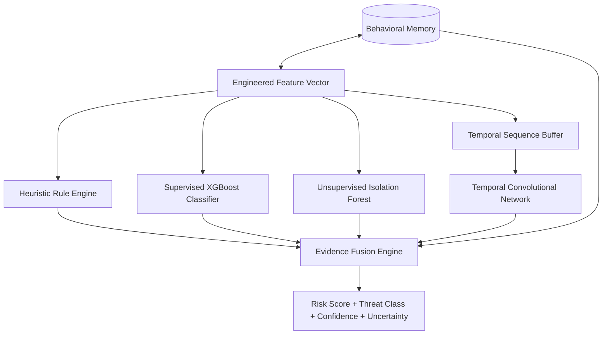

# 02_Project_Requirements.md — Project Requirements & Scope

## NETRA — Network Early Threat Recognition & Analysis

**Document Version:** 1.0  
**Depends on:** `01_SRS.md`  
**Focus:** Engineering Requirements, Scope Tiering, Technical Toolchains, and Infrastructure Specifications

---

## 1. Purpose & Scope Tiering Principle

`01_SRS.md` defines *what* functional capabilities the system must deliver. This document specifies the engineering requirements, hardware/software prerequisites, machine learning pipelines, and network specifications necessary to construct, benchmark, and demonstrate NETRA for SIH Problem Statement 26145.

### Scope Tiering Principle
Development is structured across three disciplined tiers:
- **Tier 1 (MVP — SIH Demonstration Core):** The minimum viable pipeline required to demonstrate real-time threat detection from unidirectional traffic: passive PCAP replay, flow creation, multi-view feature extraction, rule engine, XGBoost classifier, Isolation Forest anomaly detector, behavioral memory baseline comparison, calibrated evidence fusion, and an explainable SOC dashboard.
- **Tier 2 (High-Value Research / Stretch):** PyTorch TCN sequence modeling for subtle temporal escalation and jittered C2 beacons, automated baseline rollback mechanisms, learned fusion weighting, and live throughput/latency benchmark telemetry.
- **Tier 3 (Enterprise / Future Operations):** Hardware data diode optical drivers, distributed streaming via Kafka/Redpanda, multi-node Kubernetes orchestration, and centralized OpenSearch SIEM integration.

---

## 2. Functional Requirements Summary

| Subsystem | Requirement ID | Scope Tier | Core Function |
|---|---|---|---|
| **Traffic Ingest** | REQ-F-ING-01 | MVP | Passive PCAP replay at 1x–10x line rate without packet loss |
| **Traffic Ingest** | REQ-F-ING-02 | MVP | Live unidirectional NIC capture in promiscuous mode (no transmission) |
| **Flow Engine** | REQ-F-FLW-01 | MVP | 5-tuple flow aggregation with 1–5s micro-batch windows |
| **Feature Engine** | REQ-F-FEA-01 | MVP | Flow, volumetric, timing, DNS, and TLS/QUIC metadata extraction |
| **Detection: Rules** | REQ-F-RUL-01 | MVP | Declarative YAML/JSON threshold rules for 6 primary threat classes |
| **Detection: ML** | REQ-F-XGB-01 | MVP | Supervised XGBoost classifier for known multi-class attack patterns |
| **Detection: Anomaly**| REQ-F-IF-01 | MVP | Unsupervised Isolation Forest for unseen zero-day deviations |
| **Detection: Temporal**| REQ-F-TCN-01 | Stretch | 1D Dilated Temporal Convolutional Network for multi-window sequences |
| **Behavioral Memory**| REQ-F-MEM-01 | MVP | Host-specific statistical profiles with controlled baseline update & decay |
| **Evidence Fusion** | REQ-F-FUS-01 | MVP | Risk score (0–100), calibrated confidence, and uncertainty categorization |
| **Alerting** | REQ-F-ALT-01 | MVP | Standardized SIH JSON alert schema with human-readable evidence |
| **Dashboard** | REQ-F-DSH-01 | MVP | Real-time web UI showing threat stream, timeline, and throughput metrics |

---

## 3. Technical & Architectural Requirements

### 3.1 Unidirectional Compliance
- **Strict Read-Only Physical Boundary:** Under no circumstances shall the ingestion service initiate network handshakes, send TCP RST/ACK packets, broadcast ARP queries, or emit ICMP error responses.
- **Network Interface Configuration:** The data-capture network interface controller (NIC) must operate with transmit (TX) disabled at the driver/kernel level where supported, or physically isolated via an RX-only optical tap cable.
- **Zero In-Band Response:** System architecture must reject inline blocking, packet dropping, or automated firewall manipulation. Actionable intelligence is delivered via outbound alert queues strictly out-of-band.

### 3.2 Streaming & Bounded Latency
- **Incremental Micro-Batching:** Processing must execute over rolling micro-batches of $1.0 \dots 5.0$ seconds. The system must not wait for end-of-file (EOF) on packet captures or for long TCP sessions to terminate.
- **Bounded Latency Budget:**
  - Micro-batch assembly: $\le 200 \text{ ms}$
  - Feature extraction: $\le 300 \text{ ms}$
  - Model inference (Rules + XGBoost + iForest): $\le 250 \text{ ms}$
  - Fusion & Alert dispatch: $\le 150 \text{ ms}$
  - **Total Pipeline Latency:** $\le 900 \text{ ms}$ (comfortably within the $1,500 \text{ ms}$ operational threshold).

---

## 4. Software Requirements

### 4.1 Core Runtime & Environment
- **Operating System:** Linux (Ubuntu 22.04 LTS / Debian 12 recommended) or Windows 10/11 64-bit with WSL2.
- **Programming Language:** Python 3.10 or 3.11 (CPython 64-bit).
- **Package Manager:** `pip` with pinned `requirements.txt` or `poetry`.

### 4.2 Application & Service Dependencies

| Layer | Library / Tool | Minimum Version | Purpose |
|---|---|---|---|
| **Packet Parsing** | `scapy` / `dpkt` / `pyshark` | 2.5.0 / 1.9.8 | Low-level packet header parsing and PCAP stream decoding |
| **DataFrames** | `polars` / `pandas` | 0.20.0 / 2.2.0 | High-performance feature transformation and vectorization |
| **Numerical Math** | `numpy` / `scipy` | 1.26.0 / 1.12.0 | Signal entropy, statistical dispersion, IAT calculations |
| **Supervised ML** | `xgboost` | 2.0.0+ | Multi-class gradient-boosted decision trees |
| **Anomaly ML** | `scikit-learn` | 1.4.0+ | Isolation Forest and probability calibration (isotonic) |
| **Temporal ML** | `torch` (PyTorch) | 2.2.0+ (CPU/CUDA)| 1D Dilated Temporal Convolutional Network (TCN) |
| **Explainability** | `shap` | 0.44.0+ | TreeSHAP feature attribution for XGBoost alerts |
| **Backend API** | `fastapi` + `uvicorn` | 0.110.0+ | High-throughput async REST & WebSocket alert API |
| **Schema Validation** | `pydantic` | 2.6.0+ | Strict runtime typing for flows, features, and alerts |
| **Database ORM** | `SQLAlchemy` + `psycopg2` | 2.0.0+ | Relational persistence and connection pooling |
| **Database Server** | `PostgreSQL` | 15.0+ | Alert storage, entity baselines, and model registries |
| **Frontend UI** | `React` + `Vite` + `Tailwind` | React 18 / Vite 5 | Modern responsive SOC dashboard and interactive evidence drawer |

---

## 5. Hardware Requirements

### 5.1 Minimum Development / Demonstration Workstation (SIH Lab Spec)
- **Processor:** 6-core / 12-thread x86_64 CPU (Intel Core i5 11th Gen / AMD Ryzen 5 5600 or Apple M-series equivalent).
- **RAM:** 16 GB DDR4/DDR5 system memory (allocating $\sim 4\text{ GB}$ for database, $\sim 4\text{ GB}$ for Python runtime/models, $\sim 8\text{ GB}$ for OS and buffers).
- **Storage:** 256 GB NVMe SSD (minimum $1,500 \text{ MB/s}$ read rate for real-time PCAP playback).
- **Network Interface:** 1x Gigabit Ethernet NIC for ingestion (promiscuous mode enabled).

### 5.2 Recommended Benchmarking & Evaluation Server
- **Processor:** 8-core / 16-thread CPU (Intel Core i7/i9 or AMD Ryzen 7/9).
- **GPU (Optional):** NVIDIA RTX 3060 / 4060 (6 GB+ VRAM) for accelerated PyTorch TCN sequence inference; CPU inference is also fully supported.
- **RAM:** 32 GB DDR5 RAM.
- **Storage:** 1 TB NVMe SSD.
- **Network Interface:** Dual-port 10GbE NIC (Intel X520 / X540 / X710) for high-rate live tap ingestion.

---

## 6. Machine Learning Requirements

### 6.1 Model Architecture & Roles

1. **Model A — Supervised Tabular Classifier (XGBoost):**
   - **Target Threat Classes:** BENIGN, SYN_FLOOD, UDP_AMPLIFICATION, SPOOFED_FLOOD, C2_BEACON, DGA, DNS_TUNNEL, ENCRYPTED_MALWARE, PORT_SCAN, EXFILTRATION.
   - **Hyperparameters:** `n_estimators`: 200, `max_depth`: 6, `learning_rate`: 0.05, `subsample`: 0.8, `colsample_bytree`: 0.8, `tree_method`: 'hist'.
   - **Calibration:** Isotonic regression post-processor to ensure output probabilities represent true empirical confidence.

2. **Model B — Unsupervised Anomaly Detector (Isolation Forest):**
   - **Target:** Outlier detection on high-dimensional flow statistics without reliance on known attack signatures.
   - **Hyperparameters:** `n_estimators`: 150, `contamination`: 0.02, `max_samples`: 256, `random_state`: 42.

3. **Model C — Temporal Sequence Modeler (TCN):**
   - **Target:** Modeling inter-window temporal dependencies ($T = 16$ time steps).
   - **Architecture:** 3 residual blocks with 1D dilated causal convolutions (kernel size $k = 3$, dilation factors $d \in \{1, 2, 4\}$), channel width 64, dropout rate 0.2.

4. **Model D — Evidence Fusion Layer:**
   - **Mechanism:** Weighted probabilistic calibration combining detector outputs, rule triggers, and behavioral memory deviation multipliers.

### 6.2 Data Leakage & Validation Safeguards
- **Strict Scenario-Based Train/Test Split:** Datasets must never be split randomly across individual packets or flows. Splits must be partitioned strictly by **attack scenario**, **session ID**, and **time blocks** to prevent synthetic score inflation.
- **Controlled Baseline Adaptation:** High-confidence malicious traffic ($Risk \ge 50$) is permanently prevented from updating behavioral memory profiles.

---

## 7. Network & Traffic Requirements

### 7.1 Supported Telemetry Sources
- **Standard PCAP Files:** `libpcap` format, `pcapng` format containing full IP frame headers.
- **Flow Telemetry Formats:** NetFlow v5/v9, IPFIX, and sFlow records.
- **Synthetic Traffic Generation:** Lab traffic generated using `Ostinato`, `iperf3`, `TRex`, or custom Python Scapy scripts reproducing the 9 target threat scenarios.

### 7.2 Protocol Coverage
- **Network Layer:** IPv4 and IPv6 packet headers (verifying protocol, flags, TTL, fragmentation, packet size).
- **Transport Layer:** TCP (SYN/ACK flags, window size, sequence anomalies), UDP (unsolicited responses, port diversity), ICMP (type, code, rate anomalies).
- **Application Layer (Metadata Only):**
  - **DNS (53/UDP, 53/TCP):** Query length, domain string entropy, record types (A, AAAA, TXT, MX, CNAME), subdomain depth.
  - **TLS/QUIC (443/TCP, 443/UDP):** SNI server name, cipher suite rosters, extension lists, client offered curves, and computed JA3/JA4 hashes.

---

## 8. Development & Engineering Requirements

- **Code Quality & Typing:** All Python modules must utilize static type annotations (`typing` module) and validate against `ruff` or `flake8` and `mypy`.
- **Reproducibility:** All training scripts must pin random seeds (`random.seed(42)`, `np.random.seed(42)`, `torch.manual_seed(42)`).
- **Version Control Discipline:**
  - Branching strategy: Feature branches merged via tested pull requests.
  - Model artifacts (`.json`, `.joblib`, `.pt`) stored with SHA-256 integrity checksums.
  - No secret keys, credentials, or sensitive test captures committed to repository root.