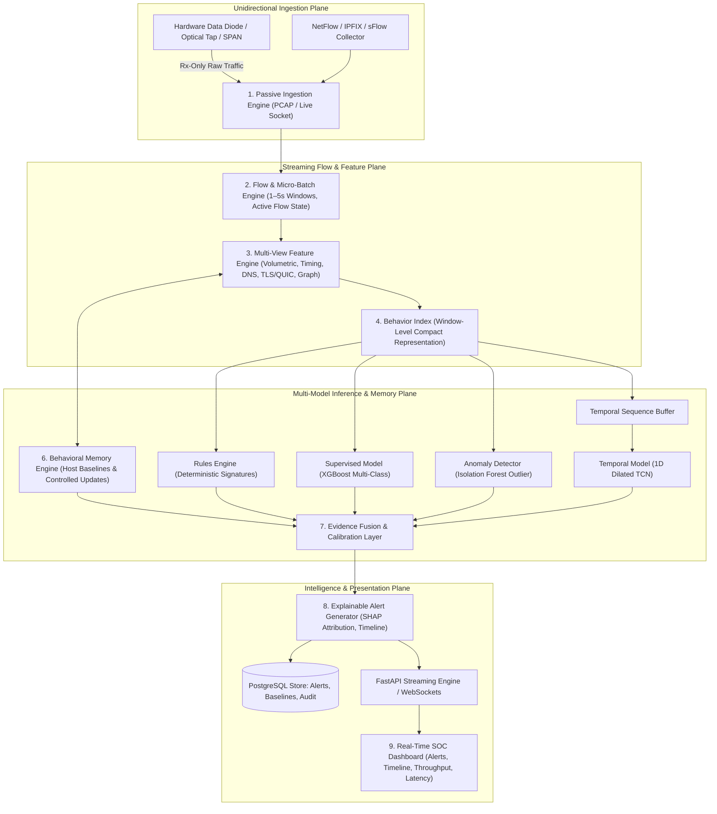
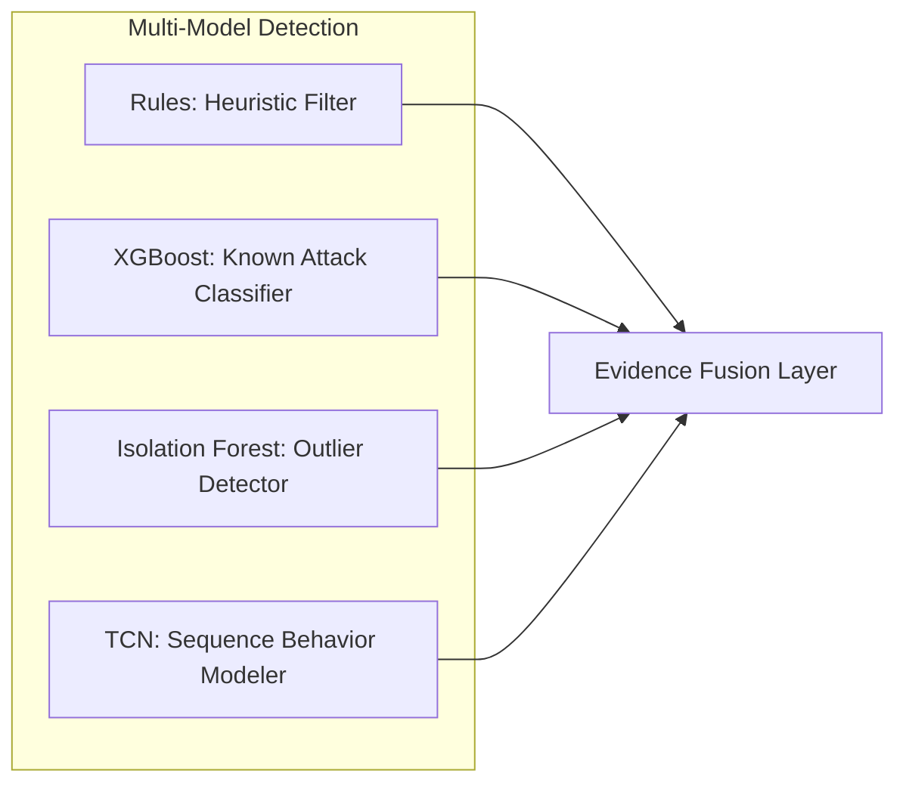
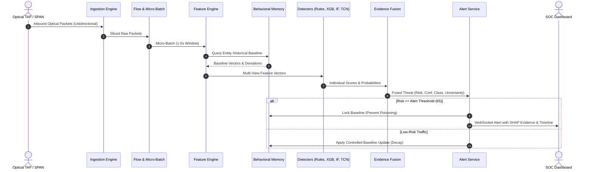

# 03_Architecture.md — System & Pipeline Architecture

## NETRA — Network Early Threat Recognition & Analysis

**Document Version:** 1.0  
**Project Identifier:** SIH 2026 • Problem Statement 26145  
**Core Architectural Rule:** Strict Unidirectional Ingest • Zero Return Path • No Active Probing • No Payload Decryption • No Inline Blocking

---

## 1. Architectural Overview & Design Philosophy

Conventional Network Intrusion Detection Systems (NIDS) are built around assumptions that fail in isolated or high-security unidirectional network enclaves:
1. They expect **bidirectional visibility** to track TCP SYN $\rightarrow$ SYN-ACK $\rightarrow$ ACK round-trips.
2. They rely on **inline enforcement** (dropping packets or sending TCP RST flags).
3. They depend on **deep packet inspection (DPI)** and payload decryption.

**NETRA (Network Early Threat Recognition & Analysis)** is engineered under strict **partial observability constraints**. It operates downstream of a physical data diode, optical tap, or SPAN port where only an inbound stream of raw packets or flow export telemetry exists.

---

## 2. End-to-End Pipeline Stages

### Stage 1: Passive Ingestion Engine
- **Telemetry Ingestion:** Receives raw Ethernet frames from an RX-only network interface (via `libpcap` or kernel raw sockets) or reads serialized PCAP/PCAPNG files at controlled replay speeds.
- **Physical Unidirectional Guarantee:** The capture interface has transmission (TX) disabled at the NIC hardware or driver level. No network packets (such as TCP handshakes, ICMP messages, or ARP queries) are ever transmitted.
- **Zero-Copy Buffering:** Packets are parsed into lightweight structures in memory ring-buffers to maintain high throughput and minimize kernel-to-userspace context switches.

### Stage 2: Flow & Micro-Batch Engine
- **5-Tuple Flow Aggregation:** Packets are assigned to unidirectional logical flows indexed by the 5-tuple:
  $$\text{Flow Key} = (\text{IP}_{\text{src}}, \text{IP}_{\text{dst}}, \text{Port}_{\text{src}}, \text{Port}_{\text{dst}}, \text{Protocol})$$
- **Micro-Batch Slicing:** Rather than waiting indefinitely for long-lived sessions to terminate, the engine processes traffic in fixed sliding micro-batches of **1 to 5 seconds** (default: 2.0s).
- **Flow State Management:** Active flow records are held in an in-memory hash table. Flows that exceed an idle timeout (e.g., 15s) or an active duration (e.g., 60s) are evicted and committed to historical summaries.

### Stage 3: Multi-View Feature Engine
The feature engine converts raw packet streams into multidimensional numerical representations across seven independent views:
1. **Flow & Volume Metrics:** Packet count, total bytes, packet length distribution (mean, standard deviation, min, max), packet rate ($p/s$), and byte rate ($B/s$).
2. **Timing & Dynamics:** Inter-arrival time (IAT) mean, variance, coefficient of variation, burstiness index, and autocorrelation periodicity score.
3. **Diversity & Fan-Out:** Shannon entropy of target IP addresses and target ports, unique connection ratios, and fan-out concentration.
4. **DNS Metadata:** Query string length, subdomain hierarchy depth, character entropy, n-gram bigram/trigram likelihood, query frequency, and NXDOMAIN ratios.
5. **TLS/QUIC Handshake Fingerprints:** Client Hello SNI, advertised cipher suites, extensions, elliptic curve identifiers, and computed JA3/JA4 cryptographic fingerprint hashes (without payload decryption).
6. **Graph & Topological Structure:** Source node out-degree, destination node in-degree, bipartite peer novelty, and connection concentration ratios.
7. **Entity Historical Deviation:** Real-time ratio deltas computed relative to established behavioral baselines for the host.

### Stage 4: Behavior Index
The Behavior Index compresses the multi-view feature space into a dense, normalized vector representing the current state of an entity or sub-network within the active micro-batch. This compact vector standardizes inputs across disparate detector models and enables low-latency streaming evaluation.

### Stage 5: Multi-Model Detection Layer
NETRA rejects the single-monolith neural network architecture in favor of a specialized four-tier detection layer:
- **Component 5A — Heuristic Rule Engine:** Fast evaluation of deterministic patterns (extreme SYN/ACK ratio anomalies, known malicious JA3 signatures, DNS query length $> 65$ bytes, unauthorized internal port sweeps).
- **Component 5B — Supervised Tabular Classifier (XGBoost):** Gradient-boosted decision tree ensemble trained on engineered tabular features to output calibrated probability distributions over known attack classes (SYN Flood, UDP Amplification, C2 Beaconing, DGA, DNS Tunnelling, Encrypted Malware, Port Scan, Exfiltration).
- **Component 5C — Unsupervised Anomaly Detector (Isolation Forest):** Analyzes feature vectors against an uncontaminated baseline of normal network operations, yielding an anomaly score $s \in [0, 1]$ to detect unseen or zero-day tactics.
- **Component 5D — Temporal Sequence Modeler (TCN):** Evaluates rolling sequences of consecutive micro-batches ($T = 16 \dots 32$ windows) using 1D dilated causal convolutions. Captures temporal dynamics such as jittered C2 beaconing, progressive port scanning, and multi-stage lateral escalation.

### Stage 6: Behavioral Memory Engine
For every critical monitored host or IP subnet, the Behavioral Memory subsystem maintains a compact statistical baseline:
- Habitual communication schedules (active hours).
- Historical packet rates and outbound byte volume distributions.
- Established destination IP peer sets and habitual service ports.
- Known TLS Client Hello JA3/JA4 fingerprints.
- Regular DNS query volume and typical domain entropy ranges.

**Poisoning Defense & Controlled Updates:**  
When an entity engages in activity that triggers risk thresholds ($Risk \ge 50$), baseline updating is immediately frozen for that entity. Validated low-risk traffic updates the baseline via an exponential moving average (EMA) with a configurable decay rate ($\alpha = 0.05$). All baselines maintain versioned checkpoints to enable rapid rollback in the event of baseline corruption.

### Stage 7: Evidence Fusion & Calibration Layer
The Evidence Fusion layer synthesizes outputs from all four detector components alongside behavioral memory deltas:
$$\mathbf{z} = \left[ P_{\text{XGB}}(\text{Class}), \; s_{\text{IF}}, \; s_{\text{TCN}}, \; \text{Score}_{\text{Rule}}, \; \Delta_{\text{Baseline}}, \; \text{Novelty}_{\text{Dst}} \right]$$
The layer outputs four calibrated signals:
1. **Threat Class:** The assigned category from the 9 supported attack families or `BENIGN`.
2. **Risk Score ($0 \dots 100$):** Compound assessment of threat severity and urgency.
3. **Confidence Score ($0 \dots 100\%$):** Post-calibrated probability (via Isotonic Regression) indicating signal alignment across detectors.
4. **Uncertainty Level (`LOW`, `MEDIUM`, `HIGH`):** Quantified degree of signal ambiguity or observational incompleteness.

### Stage 8: Explainable Alert Generator
When the calibrated Risk Score breaches the operational threshold (e.g., $Risk \ge 65$), the system emits an immutable, structured JSON alert. Each alert includes:
- Standardized SIH telemetry header (timestamp, flow ID, 5-tuple, protocol).
- Classification, risk score, confidence score, and uncertainty rating.
- Forensic evidence array detailing the top contributing features (derived from TreeSHAP values for XGBoost and high-activation time slices for TCN).
- Comparative delta against the host's historical behavioral baseline.

### Stage 9: Real-Time SOC Dashboard
- **Live Alert Stream:** Streaming WebSocket feed of prioritized security events.
- **Explainability Drawer:** Interactive drill-down displaying feature contributions, SHAP waterfall plots, and comparative baseline dials.
- **Temporal Attack Progression:** Interactive visual timeline tracking multi-stage attack escalation (e.g., Reconnaissance $\rightarrow$ Weaponization $\rightarrow$ Exfiltration).
- **System Telemetry:** Live counters measuring pipeline throughput (Mbps and flows/sec), end-to-end detection latency (ms), and memory allocation.

---

## 3. Data Flow & Communication Topology

---

## 4. Key Architectural Guarantees

| Guarantee | Mechanism | Verification Method |
|---|---|---|
| **Zero Transmit (TX)** | Kernel socket bound with `IFF_PROMISC` and TX ring disabled | Packet sniffing on tap link verifies zero transmitted frames |
| **Bounded Latency** | Sliding micro-batches with asynchronous model evaluation | System latency timers track processing delta $< 1,500\text{ ms}$ |
| **Model Poisoning Immunity** | Strict gating on baseline updates; high-risk events quarantined | Injected malicious streams fail to shift baseline thresholds |
| **Explainable Output** | TreeSHAP for tree ensembles + time-activation attribution for TCN | 100% of generated alerts contain structured human-readable reasons |
| **Deterministic Replay** | Identical timestamp replay with scenario-based state resets | Consistent detection metrics across repeated PCAP runs |