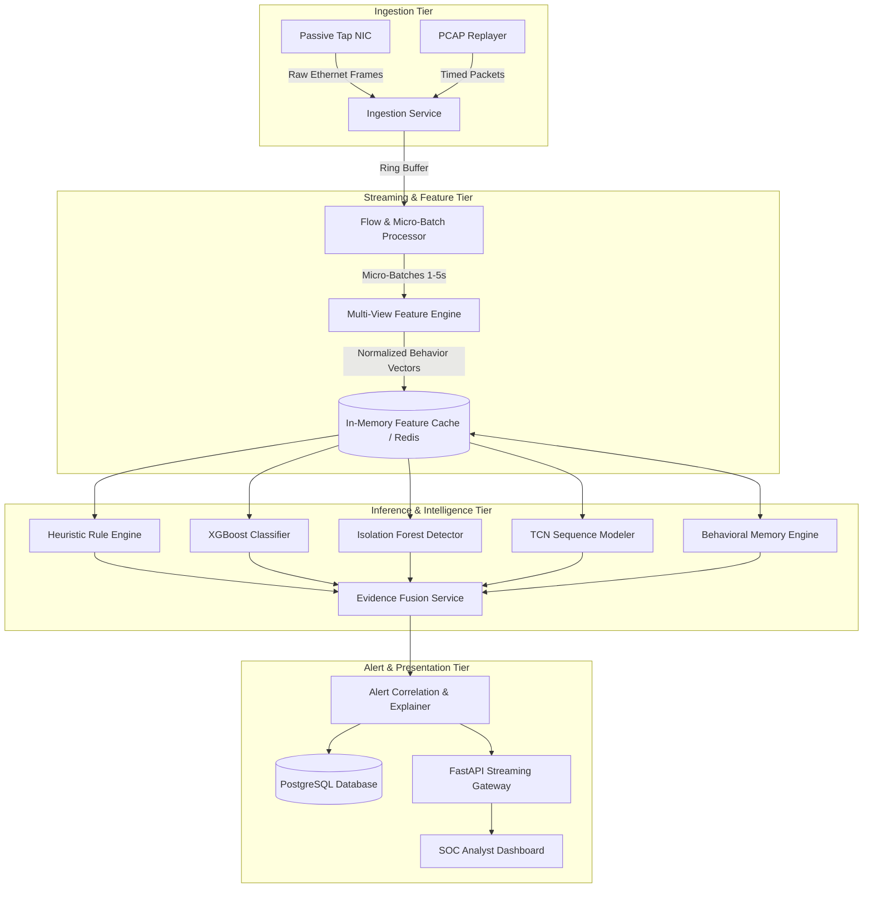
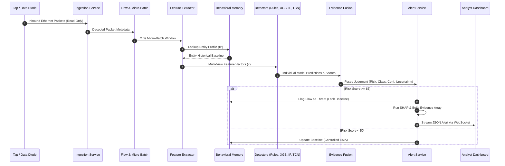

# 06_Design.md — Detailed System & Component Design

## NETRA — Network Early Threat Recognition & Analysis

**Document Version:** 1.0  
**Project Identifier:** SIH 2026 • Problem Statement 26145  
**Design Philosophy:** Decoupled, Streaming Micro-Batch Architecture with Multimodal Inference

---

## 1. System Design Overview

NETRA is designed as an asynchronous, modular threat-inference engine optimized for high-throughput, unidirectional network telemetry. The architecture eliminates single-point bottlenecks by separating network I/O from feature extraction, model inference, and alert presentation.



---

## 2. Component Design Specifications

### 2.1 Passive Ingestion Service (`backend/services/network/ingest.py`)
- **Responsibility:** Captures or reads network packets with zero Layer-2/Layer-3 transmission.
- **Interfaces:**
  - `start_pcap_replay(path: str, rate_multiplier: float)`
  - `start_live_capture(interface: str)`
- **Internal Mechanisms:**
  - Uses raw sockets with `IFF_PROMISC` flag and `SO_RCVBUF` scaled to 16 MB.
  - Zero-copy buffer passes raw binary payloads directly to packet decoders (`dpkt` / `scapy`).
  - Strict verification: socket binding does not allocate a transmission (TX) queue.

### 2.2 Flow & Micro-Batch Engine (`backend/services/network/flow_builder.py`)
- **Responsibility:** Aggregates individual packets into unidirectional 5-tuple flows and partitions them into fixed sliding time windows (1.0–5.0s).
- **Key State Structures:**
  - `ActiveFlowTable`: In-memory hash map indexed by `(src_ip, dst_ip, src_port, dst_port, protocol)`.
  - Maintains running counters: packet count, byte sum, squared byte sum (for variance), first seen timestamp, last seen timestamp, and packet inter-arrival timestamps.
- **Window Slicing:** A timer fires every window interval ($\Delta t = 2.0\text{s}$), snapshotting the active flows, emitting a micro-batch record, and resetting incremental counters.

### 2.3 Multi-View Feature Engine (`ml/features/extractor.py`)
- **Responsibility:** Transforms raw micro-batch flow records into a fixed-length numerical feature vector ($\mathbf{x} \in \mathbb{R}^D$).
- **Sub-Extractors:**
  1. `FlowVolumeExtractor`: Computes packet size mean, standard deviation, byte rate, packet rate.
  2. `TimingExtractor`: Computes mean inter-arrival time (IAT), coefficient of variation, burstiness index, and autocorrelation periodicity score.
  3. `DiversityExtractor`: Calculates destination IP/port Shannon entropy, source fan-out ratio, and unique endpoint counts.
  4. `DNSMetadataExtractor`: Extracts query string length, label count, character entropy, digit ratio, and n-gram likelihood.
  5. `TLSFingerprintExtractor`: Parses Client Hello to compute JA3/JA4 string hashes and cipher suite diversity.
  6. `GraphTopologicalExtractor`: Computes instantaneous node degree and bipartite connection concentration.

### 2.4 Multi-Model Detection Layer (`ml/models/`)
- **Rule Engine (`ml/models/rules.py`):** Evaluates deterministic conditional expressions defined in `rules.yaml` (e.g., $SYN\_Ratio > 0.95$, $DNS\_Len > 65$, $FanOut > 100$).
- **XGBoost Service (`ml/models/xgboost/`):** Evaluates tabular feature vectors against an ensemble of gradient-boosted trees; outputs probabilities for 9 threat classes + BENIGN.
- **Isolation Forest Service (`ml/models/isolation_forest/`):** Computes isolation tree path lengths on high-dimensional vectors to output normalized anomaly score $s_{\text{IF}} \in [0, 1]$.
- **TCN Sequence Modeler (`ml/models/tcn/`):** Consumes an input tensor of shape $(\text{Batch}, D, T)$ representing $T = 16$ consecutive micro-batch windows. Applies 1D dilated causal convolutions to detect temporal attack progression and periodic C2 beaconing.

### 2.5 Behavioral Memory Engine (`backend/services/behavioral_memory/`)
- **Responsibility:** Maintains host-specific baseline profiles and evaluates real-time deviations.
- **Components:**
  - `BaselineStore`: Stores statistical distributions for monitored entities (normal bytes/hour, known peer IPs, common ports, normal JA3 hashes).
  - `DeviationCalculator`: Computes normalized deviation ratios ($z$-score deltas, novelty flags).
  - `AntiPoisoningFilter`: Intercepts baseline update requests; drops updates if current risk score $\ge 50$.
  - `SnapshotManager`: Periodically commits baseline states to PostgreSQL and handles versioned rollback.

### 2.6 Evidence Fusion & Calibration Service (`backend/services/evidence_fusion/`)
- **Responsibility:** Combines heterogeneous outputs from all detectors into a unified security judgment.
- **Mathematical Formulation:**
  $$\text{Fused Risk} = w_1 \cdot P_{\text{XGB}}(\text{Threat}) + w_2 \cdot s_{\text{IF}} + w_3 \cdot s_{\text{TCN}} + w_4 \cdot \text{Score}_{\text{Rule}} + w_5 \cdot \text{Deviation}_{\text{Memory}}$$
- **Confidence Calibration:** Outputs are mapped through an Isotonic Regression calibrator trained on validation data to ensure confidence percentages represent true empirical likelihoods.
- **Uncertainty Quantification:** High disagreement between detectors or partial flow visibility sets Uncertainty to `MEDIUM` or `HIGH`.

### 2.7 Alerting & Incident Management Service (`backend/services/alerting/`)
- **Responsibility:** Correlates alerts, performs incident de-duplication, formats SIH-compliant JSON, and dispatches real-time events.
- **Incident Correlator:** Maps continuous alerts from the same source-destination pair into a single open incident thread to prevent SOC fatigue.
- **Forensic Explainer:** Executes TreeSHAP on XGBoost trees and extracts peak temporal windows from TCN to generate human-readable evidence strings.

---

## 3. Data Flow & Processing Lifecycle



---

## 4. SOC Dashboard Concept & UI Wireframe

The SOC Dashboard is structured into four primary operational zones designed for rapid situational awareness:

```
+-----------------------------------------------------------------------------------------------+
|  NETRA SOC  |  Throughput: 18,420 flows/s (124 Mbps)  |  Latency: 420 ms  |  Active Alerts: 14 |
+-----------------------------------------------------------------------------------------------+
| [ CRITICAL: 2 ]   |   [ HIGH: 5 ]   |   [ MEDIUM: 4 ]   |   [ LOW: 3 ]                        |
+-----------------------------------------------------------------------------------------------+
| LIVE ALERT STREAM                                 | ALERT EVIDENCE & FORENSIC DRAWER          |
|---------------------------------------------------|-------------------------------------------|
| Timestamp   | Class     | Src IP    | Risk | Conf | Incident ID: ALT-20260930-8491            |
| 10:30:15    | C2_BEACON | 10.0.0.45 |  88  |  92% | Threat: Botnet Command & Control          |
| 10:30:14    | DNS_TUN   | 10.0.0.12 |  91  |  95% | Target: 198.51.100.22:443 (TCP)           |
| 10:30:10    | PORT_SCAN | 192.168.1 |  74  |  86% | Uncertainty: LOW                          |
| 10:30:02    | SYN_FLOOD | 172.16.4  |  96  |  98% |-------------------------------------------|
|                                                   | EVIDENCE SUMMARY:                         |
|                                                   | * Periodic beacon interval: 30.2s ± 0.8s  |
|                                                   | * Destination IP first seen for this host |
|                                                   | * TLS JA3 hash absent in baseline (Rare)  |
|                                                   | * Outbound volume 6.4x historical normal  |
|                                                   | * TCN temporal sequence anomaly score 0.94|
|                                                   |-------------------------------------------|
|                                                   | BEHAVIOR COMPARISON:                      |
|                                                   | Normal Outbound: [==     ] 50 KB/min      |
|                                                   | Current Outbound: [============== ] 320 KB|
+---------------------------------------------------+-------------------------------------------+
```

---

## 5. Explainability Architecture

To ensure decisions can be independently verified by human analysts, NETRA enforces a three-pronged explainability model:

1. **Tree-Based Feature Attribution (TreeSHAP):**  
   For XGBoost classifications, TreeSHAP computes exact Shapley values for each feature relative to the expected model output, highlighting the top 5 positive contributors:
   $$\phi_i(\mathbf{x}) = \sum_{S \subseteq F \setminus \{i\}} \frac{|S|!(|F| - |S| - 1)!}{|F|!} \left[ f(S \cup \{i\}) - f(S) \right]$$
2. **Temporal Window Attribution:**  
   For the TCN model, gradient-weighted class activation mapping (Grad-CAM) or convolutional receptive field scoring identifies which specific micro-batch time slices within the 16-window sequence drove the anomaly score.
3. **Natural Language Evidence Synthesis:**  
   Numerical metrics are translated into concise, human-readable forensic findings (e.g., `"Inter-arrival time variance < 0.12s indicates automated beaconing"`, `"Domain character entropy 4.65 exceeds benign threshold 3.20"`).

---

## 6. Security Considerations & Pipeline Hardening

- **Enclave Network Isolation:** The host running NETRA must have strict iptables/firewall rules prohibiting outbound packet transmission on the monitoring interface.
- **Model Poisoning Immunity:** Dynamic continuous learning is disallowed; baselines are locked during high-risk activity; all baseline updates undergo exponential decay and daily snapshot versioning.
- **Adversarial Perturbation Defense:** Detectors combine orthogonal features (e.g., DNS lexical patterns + TLS metadata + timing dynamics). Perturbing one feature (such as packet size) fails to evade temporal autocorrelation and graph degree anomalies.
- **Alert Flooding Protection:** Rate-limiting token buckets and incident correlation prevent an attacker from executing denial-of-service against the SOC analyst dashboard.
- **Audit & Version Traceability:** Every alert emitted records the exact software version, rule file hash, and machine learning checkpoint identifiers used during inference.