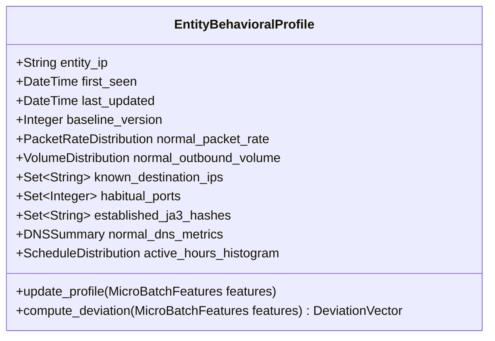
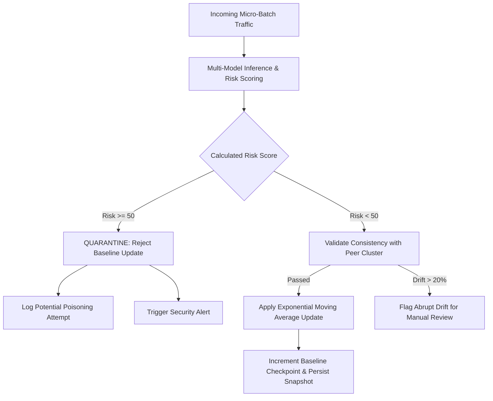
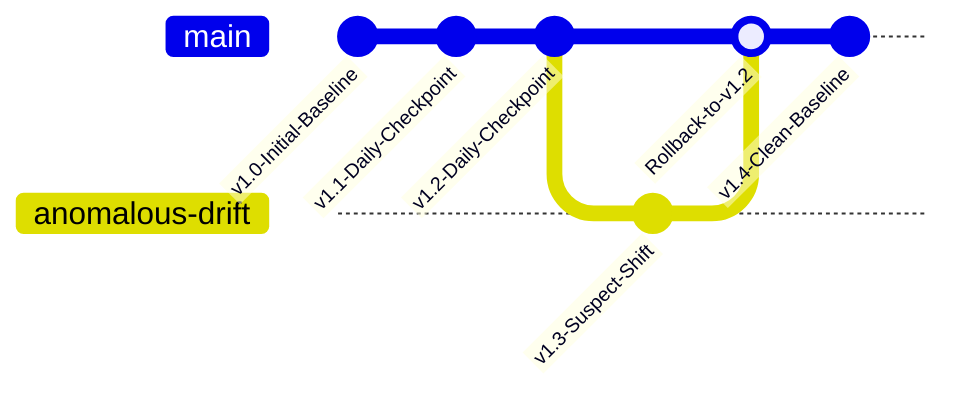

# 07_Memory.md — Entity Behavioral Memory & Anti-Poisoning Architecture

## NETRA — Network Early Threat Recognition & Analysis

**Document Version:** 1.0  
**Project Identifier:** SIH 2026 • Problem Statement 26145  
**Core Innovation:** Entity-Specific Statistical Profiling • Temporal Baseline Comparison • Controlled Adaptive Learning with Poisoning Immunity

---

## 1. Purpose & Architectural Significance

A major weakness in generic machine learning network intrusion detection systems (ML-NIDS) is reliance on a **single static global model**. What constitutes an anomaly for an administrative workstation (e.g., transmitting 2 GB of encrypted outbound traffic at 03:00 AM) might be routine operations for an automated database backup server. 

NETRA solves this through **Behavioral Memory**: maintaining compact, rolling statistical profiles for monitored network entities (individual IP addresses or internal subnets). By comparing real-time micro-batch observations against an entity's personal historical baseline, NETRA detects subtle, low-and-slow threats (such as data exfiltration and covert C2 beaconing) while drastically suppressing false positives on benign edge cases.

---

## 2. Behavioral Memory Dimensions & Profile Schema

Behavioral memory is **not raw packet storage**; it is a summarized statistical profile maintaining Gaussian distributions, rolling averages, frequency sets, and bloom filters.

### Profile Attributes per Monitored Host:

| Memory Dimension | Statistical Representation | Threat Detection Role |
|---|---|---|
| **Outbound Volumetric Rate** | Mean ($\mu$) & variance ($\sigma^2$) of bytes/min and packets/sec | Detects volumetric spikes, exfiltration bursts, and DDoS flooding. |
| **Known Destination Peer Set** | Count-min sketch / set of top-K historical peer IP addresses | Exposes destination novelty (first-seen external communication). |
| **Habitual Transport Ports** | Set of historical source/destination port numbers | Detects unusual port usage, covert service binding, or scanning. |
| **TLS/QUIC Cryptographic Profiles** | Frequency map of observed Client Hello JA3/JA4 fingerprint hashes | Identifies unauthorized malware agents running on an authorized host. |
| **DNS Query Dynamics** | Average queries/min, mean query character length, baseline entropy | Exposes DNS tunnelling, data encoding, and DGA activations. |
| **Temporal Activity Schedule** | 24-hour histogram of historical traffic volume | Detects off-hours beaconing and unauthorized nocturnal activity. |
| **Connection Density & Degree** | Mean out-degree (unique destinations contacted per hour) | Distinguishes normal browsing from automated lateral network sweeps. |

---

## 3. Behavioral Comparison & Deviation Engine

During every micro-batch window (1–5 seconds), the Feature Engine extracts current behavior ($\mathbf{x}_{\text{current}}$) and queries the Behavioral Memory subsystem for the entity's baseline profile ($\boldsymbol{\mu}_{\text{baseline}}, \boldsymbol{\sigma}_{\text{baseline}}$).

The engine computes a normalized **Deviation Vector** ($\mathbf{d}$):

$$d_k = \frac{x_{\text{current}, k} - \mu_{\text{baseline}, k}}{\sigma_{\text{baseline}, k} + \epsilon}$$

Where $\epsilon$ is a small smoothing constant ($10^{-5}$).

### Concrete Attack Illustration: Covert C2 & Exfiltration
Suppose workstation `10.0.0.25` is compromised by an adversary:
1. **Normal Baseline:**
   - Habitual outbound volume: $50 \dots 150 \text{ MB/day}$ (mean: $80 \text{ KB/min}$).
   - Known peers: Local intranet server, gateway, authorized mail server.
   - Known TLS fingerprints: Standard enterprise browser JA3.
2. **Observed Attack Session:**
   - The host establishes a connection to a newly observed external IP (`203.0.113.88`).
   - Outbound volume surges to $520 \text{ KB/min}$ ($6.5\times$ historical normal).
   - Packet timing displays strict periodicity ($30.0 \pm 1.2\text{ seconds}$).
   - Client Hello presents a rare JA3 signature never previously seen on this host.
3. **Detection Outcome:**  
   While a global model might view $520 \text{ KB/min}$ as normal traffic for a large server, the **Behavioral Memory Engine** flags a compound deviation across volume ($6.5\times$), peer novelty ($1.0$), and cryptographic rarity ($1.0$). This deviation amplifies the threat score in the Evidence Fusion layer, elevating an ambiguous signal into a high-confidence alert.

---

## 4. Controlled Baseline Updates & Anti-Poisoning Safeguards

A critical vulnerability in adaptive security systems is **model/baseline poisoning**: an attacker slowly ramps up malicious traffic over days or weeks, forcing the system to accept anomalous behavior as normal. NETRA enforces strict mathematical and architectural safeguards to prevent this failure mode.

### 4.1 Strict Risk Gating (Quarantine Threshold)
- Any micro-batch or flow that yields a **Risk Score $\ge 50$** or triggers a high-severity heuristic rule is permanently disqualified from updating baseline parameters.
- High-risk events are written to an isolated audit table to support forensic investigations.

### 4.2 Exponential Moving Average (EMA) with Bounded Decay
For confirmed low-risk traffic ($Risk < 50$), numerical baseline parameters update gradually using an exponential decay factor:
$$\mu_{t} = (1 - \alpha) \mu_{t-1} + \alpha x_t$$
$$\sigma^2_t = (1 - \alpha) \sigma^2_{t-1} + \alpha (x_t - \mu_t)^2$$
Where $\alpha$ is locked to a conservative rate ($\alpha = 0.02$). This ensures that an adversary would need months of sustained activity to significantly alter the baseline, which would trigger cumulative drift alarms.

### 4.3 Maximum Daily Drift Ceiling
Even under continuous legitimate traffic shifts, single-day baseline drift is restricted to a maximum delta of **$20\%$**. Shifts exceeding this threshold require explicit operator approval.

---

## 5. Baseline Versioning & Rollback Architecture

To ensure operational resilience, all entity baselines are maintained as versioned snapshots within PostgreSQL:

1. **Daily Checkpoints:** The system generates an immutable baseline snapshot every 24 hours (`baseline_history` table).
2. **Automated Rollback Triggers:** If an entity is subsequently confirmed compromised (e.g., retrospective threat intelligence matching), an operator or automated policy can roll back that entity's baseline to a checkpoint prior to the initial compromise date.
3. **Model Version Tagging:** Baseline records include the exact version of the feature extractor and model weights used to generate them, preventing schema mismatches during engine upgrades.

---

## 6. Contribution of Behavioral Memory to Evidence Fusion

The Behavioral Memory engine contributes three vital inputs to the Evidence Fusion layer:

1. **Normalized Volumetric Deviation ($\Delta_V$):** Quantified ratio of current bandwidth consumption to habitual average.
2. **Peer Novelty Indicator ($N_{\text{peer}} \in \{0, 1\}$):** Binary flag denoting communication with a never-before-seen IP address or external ASN.
3. **Cryptographic Consistency Score ($C_{\text{TLS}} \in [0, 1]$):** Likelihood that the observed TLS/QUIC handshake belongs to this entity's known application suite.

These metrics act as a dynamic context filter: suppressing alerts when global anomalies match an entity's known eccentricities, and elevating subtle threats when global metrics appear innocuous but violate personal history.