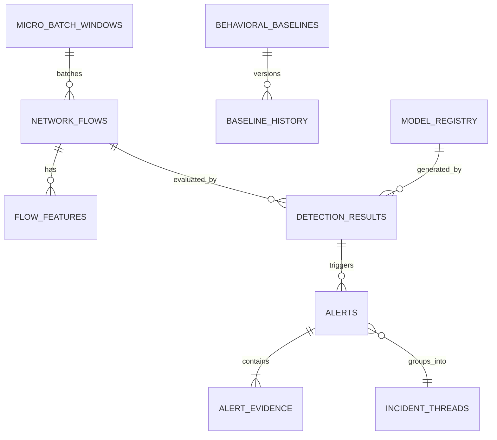

# 08_Database_Design.md — Database Architecture & Schema Specification

## NETRA — Network Early Threat Recognition & Analysis

**Document Version:** 1.0  
**Project Identifier:** SIH 2026 • Problem Statement 26145  
**Database Technology:** PostgreSQL 15+ (with optional TimescaleDB hypertable partitioning for high-rate flows)

---

## 1. Storage Architecture Overview

NETRA utilizes a relational PostgreSQL data store optimized for time-series ingestion, analytical querying, and immutable forensic auditability. The database serves three primary functions:
1. **Telemetry & Flow Store:** Short-retention storage of parsed 5-tuple network flows and extracted feature vectors.
2. **Threat Intelligence & Alert Store:** Permanent storage of correlated incidents, explainable alerts, and structured forensic evidence.
3. **Behavioral Memory & Model Registry:** Versioned historical baselines, model artifact checksums, and telemetry performance benchmarks.



---

## 2. Entity-Relationship Data Dictionary

### 2.1 Table: `micro_batch_windows`
Tracks sliding time-window batches for streaming coordination and performance benchmarking.

| Column | Data Type | Constraints | Description |
|---|---|---|---|
| `window_id` | `UUID` | Primary Key, Default: `gen_random_uuid()` | Unique window identifier |
| `start_time` | `TIMESTAMPTZ` | NOT NULL | Micro-batch start boundary |
| `end_time` | `TIMESTAMPTZ` | NOT NULL | Micro-batch end boundary |
| `duration_ms` | `INTEGER` | NOT NULL | Window duration in milliseconds (e.g., 2000) |
| `total_packets` | `INTEGER` | NOT NULL | Count of packets observed in this window |
| `total_bytes` | `BIGINT` | NOT NULL | Sum of octets observed |
| `total_flows` | `INTEGER` | NOT NULL | Count of active 5-tuple flows processed |
| `processing_latency_ms` | `DOUBLE PRECISION` | NOT NULL | Time taken to process batch to inference |

### 2.2 Table: `network_flows`
Stores reconstructed unidirectional communication flows.

| Column | Data Type | Constraints | Description |
|---|---|---|---|
| `flow_id` | `VARCHAR(64)` | Primary Key | Deterministic hash of 5-tuple + window timestamp |
| `window_id` | `UUID` | Foreign Key $\rightarrow$ `micro_batch_windows` | Associated micro-batch window |
| `start_time` | `TIMESTAMPTZ` | NOT NULL, Indexed | First observed packet timestamp in flow |
| `end_time` | `TIMESTAMPTZ` | NOT NULL | Last observed packet timestamp in flow |
| `source_ip` | `INET` | NOT NULL, Indexed | Monitored origin IP address |
| `destination_ip` | `INET` | NOT NULL, Indexed | Observed target IP address |
| `source_port` | `INTEGER` | NOT NULL | Transport origin port ($0 \dots 65535$) |
| `destination_port`| `INTEGER` | NOT NULL, Indexed | Transport service port ($0 \dots 65535$) |
| `protocol` | `VARCHAR(10)` | NOT NULL | Transport protocol (`TCP`, `UDP`, `ICMP`) |
| `packet_count` | `INTEGER` | NOT NULL | Total packets observed in flow |
| `byte_count` | `BIGINT` | NOT NULL | Total bytes transferred |
| `duration_seconds`| `DOUBLE PRECISION` | NOT NULL | Flow duration in fractional seconds |

### 2.3 Table: `flow_features`
Stores extracted multi-view feature representations derived from flows.

| Column | Data Type | Constraints | Description |
|---|---|---|---|
| `feature_id` | `UUID` | Primary Key, Default: `gen_random_uuid()` | Unique feature record identifier |
| `flow_id` | `VARCHAR(64)` | Foreign Key $\rightarrow$ `network_flows`, UNIQUE | Associated network flow |
| `mean_packet_size`| `DOUBLE PRECISION` | NOT NULL | Mean packet length in bytes |
| `std_packet_size` | `DOUBLE PRECISION` | NOT NULL | Standard deviation of packet lengths |
| `packet_rate` | `DOUBLE PRECISION` | NOT NULL | Packets observed per second |
| `byte_rate` | `DOUBLE PRECISION` | NOT NULL | Bytes transferred per second |
| `iat_mean` | `DOUBLE PRECISION` | NOT NULL | Mean packet inter-arrival time (seconds) |
| `iat_std` | `DOUBLE PRECISION` | NOT NULL | Standard deviation of inter-arrival times |
| `iat_periodicity` | `DOUBLE PRECISION` | NOT NULL | Normalized autocorrelation periodicity score |
| `dst_ip_entropy` | `DOUBLE PRECISION` | NOT NULL | Shannon entropy of destination IPs for this source |
| `dst_port_entropy`| `DOUBLE PRECISION`| NOT NULL | Shannon entropy of target ports |
| `dns_query_len` | `INTEGER` | NULL | Length of DNS query string (if DNS flow) |
| `dns_entropy` | `DOUBLE PRECISION` | NULL | Character entropy of DNS domain string |
| `dns_ngram_score` | `DOUBLE PRECISION` | NULL | Lexical n-gram anomaly score |
| `tls_ja3_hash` | `VARCHAR(32)` | NULL, Indexed | MD5 hash of TLS Client Hello parameters |
| `tls_sni` | `VARCHAR(255)` | NULL | Server Name Indication string from TLS |
| `feature_vector` | `JSONB` | NOT NULL | Full serialized numerical feature vector |

### 2.4 Table: `detection_results`
Captures intermediate inference scores across all individual detection models.

| Column | Data Type | Constraints | Description |
|---|---|---|---|
| `detection_id` | `UUID` | Primary Key, Default: `gen_random_uuid()` | Unique detection run identifier |
| `flow_id` | `VARCHAR(64)` | Foreign Key $\rightarrow$ `network_flows` | Associated network flow |
| `model_version_id`| `UUID` | Foreign Key $\rightarrow$ `model_registry` | Model bundle version utilized |
| `rule_score` | `DOUBLE PRECISION` | NOT NULL, Default: `0.0` | Heuristic rule activation score ($0 \dots 1$) |
| `rule_triggers` | `JSONB` | NULL | List of activated rule IDs |
| `xgboost_class` | `VARCHAR(32)` | NOT NULL | Supervised classification label |
| `xgboost_prob` | `DOUBLE PRECISION` | NOT NULL | Raw predicted class probability |
| `iforest_score` | `DOUBLE PRECISION` | NOT NULL | Normalized Isolation Forest outlier score ($0 \dots 1$) |
| `tcn_score` | `DOUBLE PRECISION` | NOT NULL, Default: `0.0` | Temporal sequence model threat probability |
| `memory_deviation`| `DOUBLE PRECISION`| NOT NULL | Behavioral baseline deviation multiplier |

### 2.5 Table: `incident_threads`
Aggregates repeated related alerts into single manageable security incidents.

| Column | Data Type | Constraints | Description |
|---|---|---|---|
| `incident_id` | `VARCHAR(32)` | Primary Key | Structured ID (e.g., `INC-20260930-001`) |
| `source_ip` | `INET` | NOT NULL, Indexed | Threat actor origin host |
| `target_ip` | `INET` | NOT NULL | Target destination or subnet |
| `primary_class` | `VARCHAR(32)` | NOT NULL | Dominant threat category |
| `first_seen` | `TIMESTAMPTZ` | NOT NULL | Timestamp of initial alert |
| `last_seen` | `TIMESTAMPTZ` | NOT NULL | Timestamp of most recent alert |
| `event_count` | `INTEGER` | NOT NULL, Default: `1` | Total correlated alert flows |
| `max_risk_score` | `INTEGER` | NOT NULL | Peak risk score observed |
| `incident_status` | `VARCHAR(16)` | NOT NULL, Default: `'ACTIVE'`| `'ACTIVE'`, `'INVESTIGATING'`, `'RESOLVED'` |

### 2.6 Table: `alerts`
Stores final fused security alerts conforming to the SIH JSON schema.

| Column | Data Type | Constraints | Description |
|---|---|---|---|
| `alert_id` | `VARCHAR(32)` | Primary Key | Unique alert ID (e.g., `ALT-20260930-8491`) |
| `incident_id` | `VARCHAR(32)` | Foreign Key $\rightarrow$ `incident_threads` | Parent incident thread |
| `flow_id` | `VARCHAR(64)` | Foreign Key $\rightarrow$ `network_flows` | Culprit flow identifier |
| `timestamp` | `TIMESTAMPTZ` | NOT NULL, Indexed | Alert generation timestamp |
| `threat_class` | `VARCHAR(32)` | NOT NULL, Indexed | Final threat class (e.g., `C2_BEACON`, `DGA`) |
| `severity` | `VARCHAR(16)` | NOT NULL | `CRITICAL`, `HIGH`, `MEDIUM`, `LOW` |
| `risk_score` | `INTEGER` | NOT NULL | Compound risk rating ($0 \dots 100$) |
| `confidence` | `DOUBLE PRECISION` | NOT NULL | Calibrated confidence ($0 \dots 100\%$) |
| `uncertainty` | `VARCHAR(16)` | NOT NULL | `LOW`, `MEDIUM`, `HIGH` |
| `payload_json` | `JSONB` | NOT NULL | Complete immutable SIH alert JSON |

### 2.7 Table: `alert_evidence`
Maintains discrete, explainable forensic observations supporting each alert.

| Column | Data Type | Constraints | Description |
|---|---|---|---|
| `evidence_id` | `UUID` | Primary Key, Default: `gen_random_uuid()` | Unique evidence line ID |
| `alert_id` | `VARCHAR(32)` | Foreign Key $\rightarrow$ `alerts` | Parent alert record |
| `evidence_type` | `VARCHAR(32)` | NOT NULL | `TIMING`, `BASELINE`, `LEXICAL`, `FINGERPRINT`, `SHAP` |
| `description` | `TEXT` | NOT NULL | Human-readable explanation text |
| `metric_name` | `VARCHAR(64)` | NOT NULL | Specific feature involved |
| `observed_value` | `DOUBLE PRECISION` | NOT NULL | Current observed numeric value |
| `baseline_value` | `DOUBLE PRECISION` | NULL | Normal expected baseline value |
| `importance_weight`| `DOUBLE PRECISION`| NOT NULL | Relative contribution weight / SHAP value |

### 2.8 Table: `behavioral_baselines`
Stores host-specific statistical profiles for the Behavioral Memory engine.

| Column | Data Type | Constraints | Description |
|---|---|---|---|
| `entity_ip` | `INET` | Primary Key | Monitored host IP address |
| `version` | `INTEGER` | NOT NULL, Default: `1` | Current baseline version number |
| `first_seen` | `TIMESTAMPTZ` | NOT NULL | Initial observation timestamp |
| `last_updated` | `TIMESTAMPTZ` | NOT NULL | Timestamp of most recent EMA update |
| `mean_bytes_per_sec`| `DOUBLE PRECISION`| NOT NULL | Mean outbound byte bandwidth |
| `std_bytes_per_sec` | `DOUBLE PRECISION`| NOT NULL | Standard deviation of bandwidth |
| `mean_packets_per_sec`| `DOUBLE PRECISION`| NOT NULL | Mean packet frequency |
| `known_destinations`| `JSONB` | NOT NULL, Default: `'[]'` | List of verified destination IPs |
| `habitual_ports` | `JSONB` | NOT NULL, Default: `'[]'` | List of habitual destination ports |
| `known_ja3_hashes` | `JSONB` | NOT NULL, Default: `'[]'` | Approved TLS Client Hello signatures |
| `mean_dns_rate` | `DOUBLE PRECISION` | NOT NULL, Default: `0.0` | Normal DNS queries per minute |
| `is_locked` | `BOOLEAN` | NOT NULL, Default: `FALSE` | Freeze updates during active compromise |

### 2.9 Table: `baseline_history`
Maintains immutable snapshots of entity baselines to enable rollback and audit drift.

| Column | Data Type | Constraints | Description |
|---|---|---|---|
| `snapshot_id` | `UUID` | Primary Key, Default: `gen_random_uuid()` | Unique snapshot identifier |
| `entity_ip` | `INET` | Foreign Key $\rightarrow$ `behavioral_baselines` | Target host IP |
| `version` | `INTEGER` | NOT NULL | Version identifier at snapshot time |
| `snapshot_timestamp`| `TIMESTAMPTZ` | NOT NULL | Snapshot creation timestamp |
| `profile_data` | `JSONB` | NOT NULL | Complete serialized baseline state |

### 2.10 Table: `model_registry`
Tracks ML model weights, training checkpoints, and validation metrics for full auditability.

| Column | Data Type | Constraints | Description |
|---|---|---|---|
| `model_id` | `UUID` | Primary Key, Default: `gen_random_uuid()` | Unique model registration ID |
| `model_name` | `VARCHAR(64)` | NOT NULL | `xgboost_known_threat`, `iforest_anomaly`, `tcn_temporal` |
| `version_tag` | `VARCHAR(32)` | NOT NULL | Version string (e.g., `v1.2.0`) |
| `artifact_sha256` | `VARCHAR(64)` | NOT NULL | Cryptographic hash of model weights file |
| `training_dataset`| `VARCHAR(128)` | NOT NULL | Reference to training PCAP/feature dataset |
| `macro_f1_score` | `DOUBLE PRECISION` | NOT NULL | Macro F1 achieved during offline validation |
| `registered_at` | `TIMESTAMPTZ` | NOT NULL | Registration timestamp |
| `is_active` | `BOOLEAN` | NOT NULL, Default: `TRUE` | Whether currently deployed in live inference |

---

## 3. Data Retention & Partitioning Strategy

Because high-speed network telemetry can generate gigabytes of records daily, NETRA enforces a tiered data lifecycle policy:

```
[ Ingested Raw Flows ] ----( 24 Hours )----> Purged from `network_flows`
[ Extracted Features ] ----( 48 Hours )----> Purged from `flow_features`
[ Suspicious Detections ] -( 30 Days )-----> Archived
[ Security Alerts ] -------( 1 Year )------> Retained permanently in `alerts` & `alert_evidence`
[ Behavioral Baselines ] --( Permanent )---> Updated via EMA & versioned in `baseline_history`
```

1. **Partitioning:** If TimescaleDB is enabled, `network_flows` and `flow_features` are converted into hypertables partitioned in 4-hour time chunks. In standard PostgreSQL, table inheritance partitioning on `start_time` is used.
2. **Indexing Strategy:**
   - B-Tree index on `(source_ip, start_time)` for fast host historical lookups.
   - Hash index on `flow_id` for $O(1)$ alert linkage.
   - GIN index on `alerts.payload_json` and `alert_evidence.description` for rapid full-text and attribute search in the SOC dashboard.