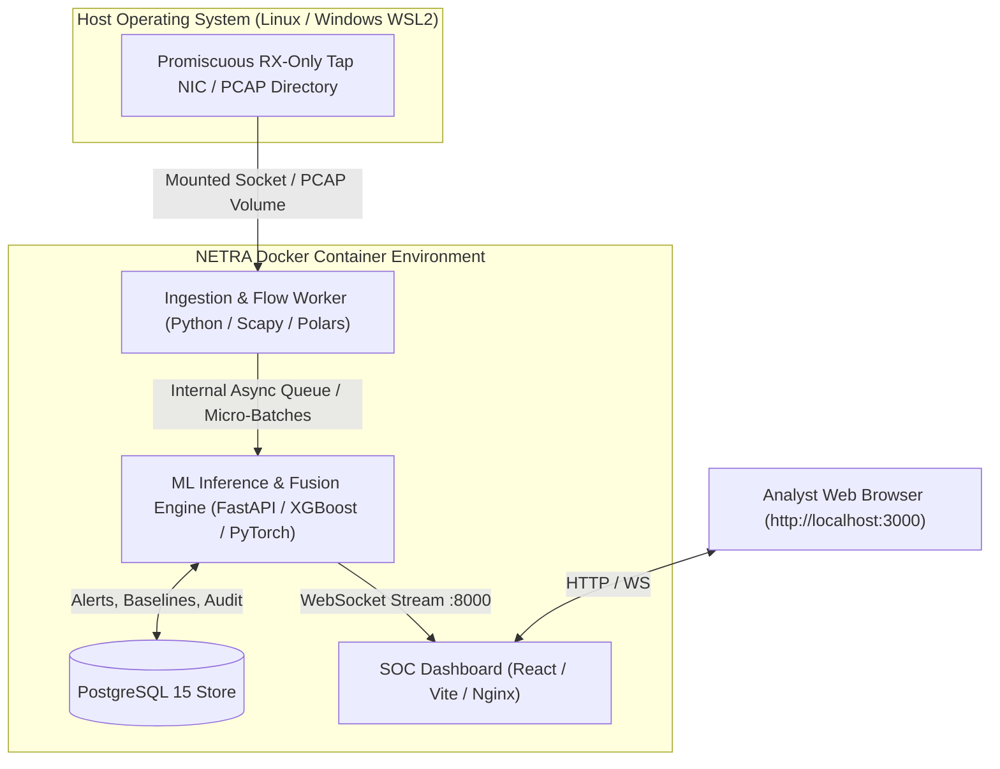

# 10_Deployment.md — Deployment Architecture & Operations Guide

## NETRA — Network Early Threat Recognition & Analysis

**Document Version:** 1.0  
**Project Identifier:** SIH 2026 • Problem Statement 26145  
**Deployment Strategy:** Reproducible, Single-Command Dockerized Environment with Zero Outbound Network Dependencies

---

## 1. Deployment Philosophy

NETRA is designed to operate in highly restricted, air-gapped, or isolated security enclaves. To ensure ease of demonstration for the SIH jury while maintaining architectural fidelity to real-world data diode environments, NETRA avoids unnecessary distributed bloat (such as requiring multi-broker Kafka clusters or heavy Kubernetes control planes for local demos) and packages all services into a high-performance **Docker Compose** topology.



---

## 2. Practical Deployment Topologies

### 2.1 Topology A: SIH Evaluation & Local Demonstration Spec (Recommended)
- **Deployment Mode:** Single-host Docker Compose deployment on developer laptop or evaluation workstation.
- **Data Source:** Synthetic and recorded PCAP scenarios replayed via local loopback or software virtual interfaces.
- **Resource Footprint:** 4 CPU cores, 8 GB RAM, 20 GB disk space.
- **Port Bindings:**
  - `3000`: SOC Dashboard Frontend (Nginx)
  - `8000`: FastAPI Backend & WebSocket API
  - `5432`: PostgreSQL Database (internal bridge or exposed for debugging)

### 2.2 Topology B: Isolated Physical Data Diode Enclave
- **Deployment Mode:** Bare-metal Linux server downstream of an optical data diode or hardware TAP.
- **Ingestion NIC:** Intel Gigabit/10GbE NIC with transmit pins physically severed or RX-only kernel binding (`ethtool -K eth1 rx on tx off`).
- **Management Interface:** Dedicated out-of-band Ethernet port connecting strictly to the internal SOC monitoring segment.
- **No Default Gateway on Tap Interface:** Prevents any inadvertent packet routing or network discovery.

---

## 3. Container Services Specification

NETRA is partitioned into four decoupled containers defined in `docker-compose.yml`:

| Service Name | Base Image | Responsibilities | Key Dependencies |
|---|---|---|---|
| `db` | `postgres:15-alpine` | Persists alerts, incident threads, entity baselines, model metadata. | Healthcheck on `pg_isready` |
| `backend` | `python:3.10-slim` | Ingestion daemon, micro-batching, feature extraction, ML inference (XGBoost, iForest, TCN), behavioral memory, evidence fusion, and FastAPI REST/WebSocket server. | `db` (healthy) |
| `frontend` | `node:20-alpine` (builder) $\rightarrow$ `nginx:alpine` | Pre-compiled React + Vite + Tailwind CSS single-page application serving the SOC dashboard. | `backend` (accessible) |
| `pcap-replayer` (Demo Profile) | `python:3.10-slim` | Interactive CLI tool to replay specific SIH attack PCAPs at controlled speeds. | `backend` |

---

## 4. Environment Configuration (`.env.example`)

```ini
# ==============================================================================
# NETRA — Environment Configuration
# ==============================================================================

# System Environment
ENVIRONMENT=production
LOG_LEVEL=INFO
SECRET_KEY=netra-sih-2026-unidirectional-threat-intelligence

# Database Configuration
POSTGRES_USER=netra_admin
POSTGRES_PASSWORD=netra_secure_password_2026
POSTGRES_DB=netra_db
POSTGRES_HOST=db
POSTGRES_PORT=5432

# Ingestion Settings
CAPTURE_MODE=pcap_replay       # Options: pcap_replay, live_interface
LIVE_INTERFACE=eth0
PCAP_DIR=/app/data/test
DEFAULT_REPLAY_SPEED=1.0       # 1.0 = real-time, 2.0 = 2x speed

# Micro-Batch & Streaming Configuration
MICRO_BATCH_WINDOW_SECONDS=2.0
FLOW_IDLE_TIMEOUT_SECONDS=15.0
FLOW_ACTIVE_TIMEOUT_SECONDS=60.0

# Detection & Model Thresholds
ALERT_RISK_THRESHOLD=65
QUARANTINE_RISK_THRESHOLD=50
BASELINE_DECAY_ALPHA=0.02
MAX_DAILY_BASELINE_DRIFT=0.20

# Model Paths
MODEL_DIR=/app/ml/models
XGBOOST_MODEL_PATH=/app/ml/models/xgboost/xgboost_known_v1.json
IFOREST_MODEL_PATH=/app/ml/models/isolation_forest/iforest_v1.joblib
TCN_MODEL_PATH=/app/ml/models/tcn/tcn_temporal_v1.pt
```

---

## 5. Docker Compose Reference (`docker-compose.yml`)

```yaml
version: '3.8'

services:
  db:
    image: postgres:15-alpine
    container_name: netra-postgres
    restart: always
    environment:
      POSTGRES_USER: ${POSTGRES_USER:-netra_admin}
      POSTGRES_PASSWORD: ${POSTGRES_PASSWORD:-netra_secure_password_2026}
      POSTGRES_DB: ${POSTGRES_DB:-netra_db}
    ports:
      - "5432:5432"
    volumes:
      - pgdata:/var/lib/postgresql/data
    healthcheck:
      test: ["CMD-SHELL", "pg_isready -U netra_admin -d netra_db"]
      interval: 5s
      timeout: 5s
      retries: 5

  backend:
    build:
      context: .
      dockerfile: infrastructure/docker/backend.Dockerfile
    container_name: netra-backend
    restart: always
    depends_on:
      db:
        condition: service_healthy
    env_file:
      - .env
    volumes:
      - ./data:/app/data
      - ./ml/models:/app/ml/models
    ports:
      - "8000:8000"

  frontend:
    build:
      context: .
      dockerfile: infrastructure/docker/frontend.Dockerfile
    container_name: netra-frontend
    restart: always
    depends_on:
      - backend
    ports:
      - "3000:80"

volumes:
  pgdata:
```

---

## 6. Step-by-Step Deployment Instructions

### 6.1 Prerequisites
- Docker Engine version 24.0+ and Docker Compose v2.20+.
- Minimum 8 GB free system RAM.
- Git (for source checkout).

### 6.2 Launching the Stack
1. Clone the repository and navigate into the project directory:
   ```bash
   cd NETRA
   ```
2. Copy the sample environment file:
   ```bash
   cp .env.example .env
   ```
3. Build and launch all services in detached mode:
   ```bash
   docker compose up --build -d
   ```
4. Verify all containers are healthy:
   ```bash
   docker compose ps
   ```
5. Open the SOC Analyst Dashboard in a browser:
   ```
   http://localhost:3000
   ```

### 6.3 Executing the Interactive SIH Demonstration
To execute the live PCAP replay scenarios before evaluators:
```bash
docker compose exec backend python backend/services/network/replay_scenarios.py --scenario sih_demo
```
The dashboard at `http://localhost:3000` will immediately begin rendering real-time flows, latency statistics, and threat alerts as the attack scenarios unfold.

---

## 7. Security Hardening for Production Enclaves

1. **Non-Root Container Execution:** All Dockerfiles specify an unprivileged `netra` user (`UID 10001`) to run application processes.
2. **Read-Only Root Filesystem:** Production containers mount the host root as read-only (`read_only: true`), writing transient micro-batches to an isolated in-memory `tmpfs` buffer.
3. **Database Network Isolation:** The PostgreSQL container is accessible solely through the internal Docker bridge network (`netra-internal-net`), without exposing port 5432 to external interfaces.
4. **Zero Outbound Access:** Container network configuration sets egress routing tables to null, ensuring no telemetry or analytical data can escape the isolated enclave.